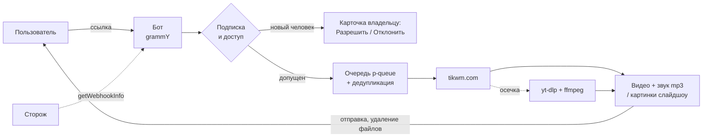

<div align="center">


# TikTok Downloader Bot

**Telegram-бот: видео и слайдшоу из TikTok без водяного знака — прямо в чат**<br>
<sub>Telegram bot that downloads TikTok videos and photo posts in the best available quality, with a two-source fallback and a self-healing watchdog</sub>

[](https://t.me/dwl_robot)


**[▶ Открыть в Telegram](https://t.me/dwl_robot)** · доступ по запросу

</div>

---

Присылаешь ссылку на TikTok и получаешь видео в лучшем качестве и отдельно звук в mp3. Для слайдшоу приходят все картинки и звук. Бот личный: каждого нового человека владелец одобряет одной кнопкой.

### 📈 В работе

На 12.11.2026, без владельца: доступ одобрен **111 людям**, скачивали **45**, из них **29** за последние 30 дней. Всего **395 скачиваний**, удачных **98%** (387).

## ✨ Возможности

- 📹 **Видео** → присылает mp4 (видео **со звуком**) **и отдельным сообщением
  сам звук в mp3**.
- 🖼 **Фото-посты (слайдшоу)** → присылает обложку + звук поста (mp3).
- 🔗 Понимает обычные и короткие ссылки: `tiktok.com/...`, `vm.tiktok.com`,
  `vt.tiktok.com`.
- 🧵 **Очередь загрузок** с ограничением параллелизма и **дедупликацией**
  одинаковых ссылок (два человека с одной ссылкой = одна загрузка).
- 🛡 **Лимит на пользователя** (скользящее окно) — защита от перегрузки и бана IP.
- 💬 Понятные сообщения об ошибках вместо «сырых» логов yt-dlp.
- 🔔 Тихие уведомления администратору о проблемах сервера (бан IP, мало места,
  сломан yt-dlp).
- ♻️ Устойчивость: одна зависшая загрузка не останавливает бота, предел времени
  на задачу, сторож «сообщения не забираются → перезапуск», graceful shutdown,
  автоперезапуск под PM2, автообновление yt-dlp по cron (подробно — «🩺 Надёжность»).
- 📢 **Вход по подписке** на канал владельца: подписался один раз, больше не спрашивают.

## 🔒 Доступ по запросу

Бот не публичный. Пишет незнакомый человек — владелец получает карточку с кнопками
**«Разрешить» / «Отклонить»**, решение сохраняется на диске и переживает рестарт.
Никакой открытой регистрации: каждый новый человек утверждается лично, вручную,
одной кнопкой (см. `src/access.js`).

## 🤖 Команды

| Команда | Кто может | Что делает |
|---------|-----------|-----------|
| `/start`, `/help` | допущенные | приветствие и инструкция |
| `/ping` | допущенные | проверка, что бот жив (`🏓 pong`) |
| `/stats` | только владелец | аптайм, успешные/ошибочные загрузки, состояние очереди |
| `/users` | только владелец | список, кому разрешён доступ |
| `/revoke <id>` | только владелец | отозвать доступ у конкретного id |
| `/activeusers` | только владелец | кто реально скачивал, по последней активности |

Отправка **ссылки** запускает скачивание.

---

## 🏗 Как это устроено



> Файлы > 50 МБ Telegram через облачный API не отправляет — такие бот вежливо
> отклоняет. Для TikTok это редкость. (На будущее: путь к API вынесен в
> `TELEGRAM_API_ROOT` — если поднять локальный Bot API, лимит вырастет до 2 ГБ.)

### Структура

| Файл | Назначение |
|------|-----------|
| `src/config.js` | чтение `.env`, значения по умолчанию |
| `src/urls.js` | валидация и извлечение TikTok-ссылок (whitelist доменов) |
| `src/downloader.js` | вызов yt-dlp через `execFile` (без shell), ffmpeg/ffprobe, очистка tmp |
| `src/errors.js` | перевод ошибок yt-dlp в понятные пользователю сообщения |
| `src/limits.js` | rate-limit на пользователя (in-memory, скользящее окно) |
| `src/tikwm.js` | основной источник: tikwm.com (все картинки слайдшоу, видео без водяного знака) |
| `src/access.js` | доступ по запросу: допущенные и ждущие (`data/allowed.json`) |
| `src/channel.js` | вход по подписке на канал (`data/subscribed.json`) |
| `src/usage.js` | журнал скачиваний (`data/usage.jsonl`) для `/stats` и `/activeusers` |
| `src/queue.js` | очередь загрузок + дедупликация ссылок |
| `src/bot.js` | хендлеры grammY, команды, отправка контента |
| `src/index.js` | запуск, graceful shutdown, глобальные перехватчики ошибок |
| `ecosystem.config.cjs` | конфиг PM2 |
| `scripts/update-ytdlp.sh` | самообновление yt-dlp для cron |

### Откуда берётся видео

Сначала **tikwm.com** (быстро, без водяного знака, все картинки слайдшоу). Любая осечка
(сеть, нет ссылки, файл больше лимита) — запасной путь через **yt-dlp**. Если и он не
смог — понятное сообщение человеку.

### Данные на диске (`data/`, в git не попадает)

| Файл | Что лежит |
|------|-----------|
| `allowed.json` | кому разрешён доступ и кто ждёт решения |
| `subscribed.json` | кто прошёл вход по подписке |
| `usage.jsonl` | по строке на скачивание: когда, кто, удачно ли |

## 🧠 Инженерные решения и надёжность

| Задача | Решение |
|---|---|
| TikTok часто ломает загрузчики | Два источника: сначала **tikwm.com** (без водяного знака, все картинки слайдшоу), при любой осечке — **yt-dlp**. yt-dlp обновляется по cron |
| Два человека прислали одну ссылку | **Дедупликация** в очереди: одна загрузка, оба получают результат |
| Ссылка из сообщения в командной строке | yt-dlp запускается через `execFile` массивом аргументов, без shell: внедрить команду через URL нельзя. Домены — по белому списку |
| Бан IP и перегрузка | Очередь с паузой между стартами, лимит на пользователя скользящим окном, проверка свободного места |
| Отправка видео в Telegram зависла навсегда | Обработчик сообщения не ждёт задачу: бот сразу берёт следующее сообщение, остальные пользователи не страдают. Сама задача ограничена временем `DOWNLOAD_TIMEOUT_SEC` + 10 минут, потом человек получает «попробуйте ещё раз» |
| Бот перестал забирать сообщения, хотя процесс жив | **Сторож**: раз в 5 минут смотрит `getWebhookInfo`. Если непрочитанные сообщения висят 3 проверки подряд (15 минут), процесс выходит, PM2 поднимает его заново |
| Telegram просит подождать (429) | `@grammyjs/auto-retry`: ждёт и повторяет |
| Повтор отправки после сбоя | Видео и звук отправляются по **пути к файлу**, а не потоком: поток нельзя прочитать второй раз |
| Видео больше `MAX_FILESIZE_MB` | yt-dlp молча пропускает такой файл, бот это распознаёт и отвечает «📦 Видео больше N МБ» |
| Мало места на диске | Загрузки приостанавливаются, владелец получает уведомление |
| Необработанная ошибка | Пишется в журнал, процесс не падает (`unhandledRejection`, `uncaughtException`) |

---

## 🚀 Быстрый старт (локально)

Нужны: **Node.js 20+**, **yt-dlp** и **ffmpeg** (ffmpeg включает ffprobe).

```bash
git clone https://github.com/digmen/tiktok-downloader.git
cd tiktok-downloader
npm install

cp .env.example .env      # впишите BOT_TOKEN (от @BotFather)
npm start                 # или: npm run dev  (автоперезапуск при правках)
```

Если yt-dlp/ffmpeg не в `PATH`, укажите пути явно в `.env`
(`YTDLP_PATH`, `FFMPEG_PATH`, `FFPROBE_PATH`).

Получить свой `ADMIN_CHAT_ID` можно у [@userinfobot](https://t.me/userinfobot).

---

## 🖥 Установка на VPS (Ubuntu/Debian, PM2)

### 1. Отдельный пользователь (не root) и рабочая папка

```bash
sudo adduser --disabled-password --gecos "" tiktokbot
sudo mkdir -p /var/tiktokbot/tmp
sudo chown -R tiktokbot:tiktokbot /var/tiktokbot
```

### 2. Node.js 22 (NodeSource) + ffmpeg

```bash
curl -fsSL https://deb.nodesource.com/setup_22.x | sudo -E bash -
sudo apt-get install -y nodejs ffmpeg
```

### 3. yt-dlp (standalone-бинарник, НЕ через apt/pip — там старые версии)

```bash
sudo curl -L https://github.com/yt-dlp/yt-dlp/releases/latest/download/yt-dlp \
  -o /usr/local/bin/yt-dlp
sudo chmod a+rx /usr/local/bin/yt-dlp
yt-dlp --version
```

### 4. PM2 + код

```bash
sudo npm install -g pm2

# залейте проект (git clone / scp) в /opt/tiktok-bot
sudo chown -R tiktokbot:tiktokbot /opt/tiktok-bot
sudo -u tiktokbot bash -c 'cd /opt/tiktok-bot && npm install --omit=dev'
```

### 5. Конфигурация

```bash
cd /opt/tiktok-bot
sudo -u tiktokbot cp .env.example .env
sudo -u tiktokbot nano .env
sudo -u tiktokbot chmod 600 .env
```

Для VPS в `.env`:

```
BOT_TOKEN=<токен от @BotFather>
ADMIN_CHAT_ID=<ваш id от @userinfobot>
YTDLP_PATH=/usr/local/bin/yt-dlp
FFMPEG_PATH=/usr/bin/ffmpeg
FFPROBE_PATH=/usr/bin/ffprobe
TMP_DIR=/var/tiktokbot/tmp
```

### 6. Запуск и автозапуск

```bash
sudo -u tiktokbot bash -c 'cd /opt/tiktok-bot && pm2 start ecosystem.config.cjs'
sudo -u tiktokbot pm2 save
pm2 startup systemd -u tiktokbot --hp /home/tiktokbot   # выполнить подсказанную команду
```

### 7. Ротация логов

```bash
sudo -u tiktokbot pm2 install pm2-logrotate
sudo -u tiktokbot pm2 set pm2-logrotate:max_size 10M
sudo -u tiktokbot pm2 set pm2-logrotate:retain 7
```

### 8. Автообновление yt-dlp (важно — TikTok часто ломает извлечение)

```bash
sudo crontab -e
# добавить строку:
0 5 * * * YTDLP_PATH=/usr/local/bin/yt-dlp /opt/tiktok-bot/scripts/update-ytdlp.sh >> /var/log/ytdlp-update.log 2>&1
```

### 9. Firewall (входящие порты не нужны — long polling)

```bash
sudo ufw allow OpenSSH
sudo ufw enable
```

---

## 🎛 Управление (PM2)

```bash
pm2 status                 # статус
pm2 logs tiktok-bot        # логи
pm2 restart tiktok-bot     # перезапуск
pm2 monit                  # память / CPU
```

### 🧯 Если бот замолчал

Процесс может быть `online` и при этом не отвечать. Проверка снаружи:

```bash
curl -s "https://api.telegram.org/bot<TOKEN>/getWebhookInfo"
# "pending_update_count": 0 — бот забирает сообщения
# больше 0 и не уменьшается — бот не читает: смотрите pm2 logs и перезапускайте
```

Зависшие задачи оставляют папки в `tmp/` — их чистит `cleanupOrphans()` при запуске.

## ⚙️ Настройки (`.env`)

| Переменная | По умолчанию | Что делает |
|-----------|--------------|-----------|
| `BOT_TOKEN` | — (обязательно) | токен бота от @BotFather |
| `OWNER_ID` | — (обязательно) | ваш Telegram-id: всегда допущен, получает карточки запросов доступа |
| `ADMIN_CHAT_ID` | — | Telegram-id для `/stats` и алертов (обычно = `OWNER_ID`) |
| `CHANNEL` | `@DigmenDevLogs` | канал, на который нужно подписаться перед использованием (пусто = без проверки). Бот должен быть админом канала (права не нужны), иначе проверка пропускает всех и раз в сутки напоминает владельцу |
| `YTDLP_PATH` | `yt-dlp` | путь к бинарнику yt-dlp |
| `FFMPEG_PATH` | `ffmpeg` | путь к ffmpeg (склейка, извлечение звука) |
| `FFPROBE_PATH` | `ffprobe` | путь к ffprobe (метаданные) |
| `TMP_DIR` | `./tmp` | папка временных файлов |
| `QUEUE_CONCURRENCY` | 2 | сколько загрузок одновременно |
| `QUEUE_MAX_SIZE` | 20 | макс. длина очереди ожидания |
| `USER_LIMIT_COUNT` | 5 | видео на пользователя в окне |
| `USER_LIMIT_WINDOW_MIN` | 60 | длина окна лимита, минуты |
| `MAX_FILESIZE_MB` | 49 | потолок размера файла (лимит Telegram) |
| `DOWNLOAD_TIMEOUT_SEC` | 300 | таймаут одной загрузки |
| `MIN_FREE_DISK_MB` | 2000 | мин. свободного места для старта загрузки |
| `TELEGRAM_API_ROOT` | — | свой Bot API (для файлов > 50 МБ); пусто = облачный |

---

## 📜 История сбоев

- **08.11–12.11.2026 — бот молчал 4,5 дня.** Видео скачалось, а отправка в Telegram зависла
  без ошибки. grammY берёт следующее сообщение только после конца обработчика, поэтому
  один повисший обработчик остановил всех: процесс `online`, ошибок в журнале нет, а сообщения копятся.
  Исправлено: обработчик не ждёт задачу, предел времени на задачу, отправка по пути файла, сторож.

## ⚠️ Дисклеймер

Бот, как и все подобные, нарушает условия использования TikTok. Возможный
риск — ограничение загрузок с IP сервера. Очередь, паузы между задачами и
лимиты на пользователя эти риски снижают. Ответственность за использование
несёт владелец сервера.

## 📄 Лицензия

[MIT](LICENSE)
